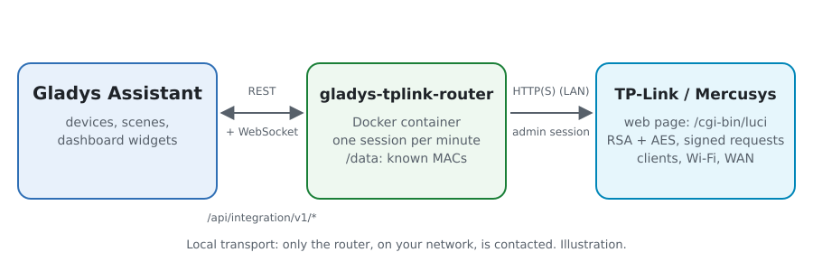
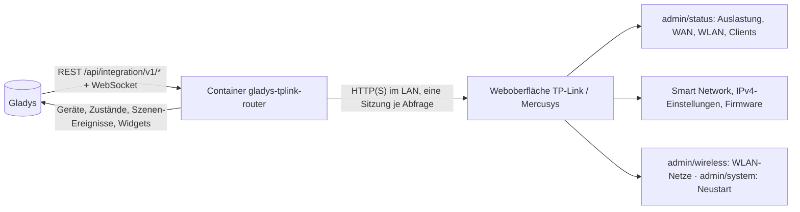
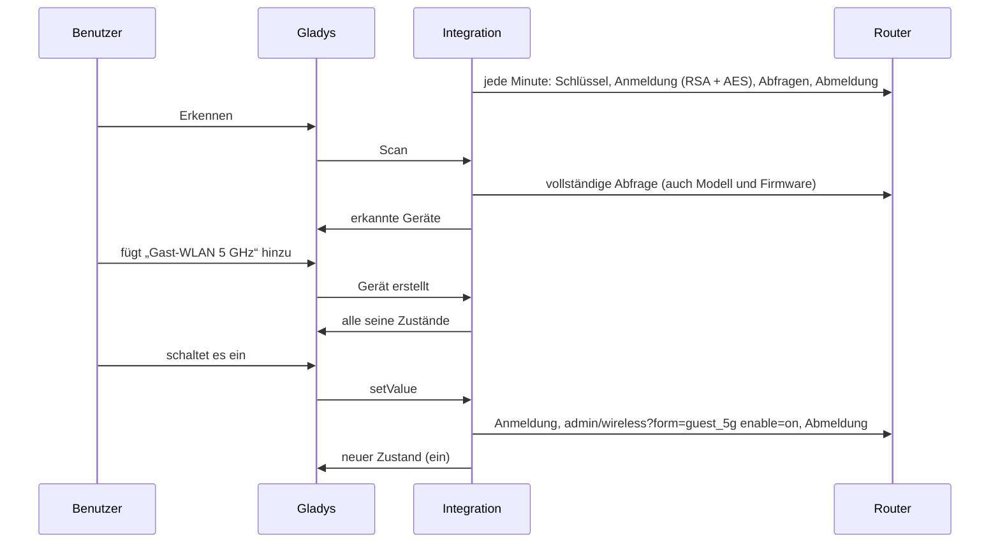
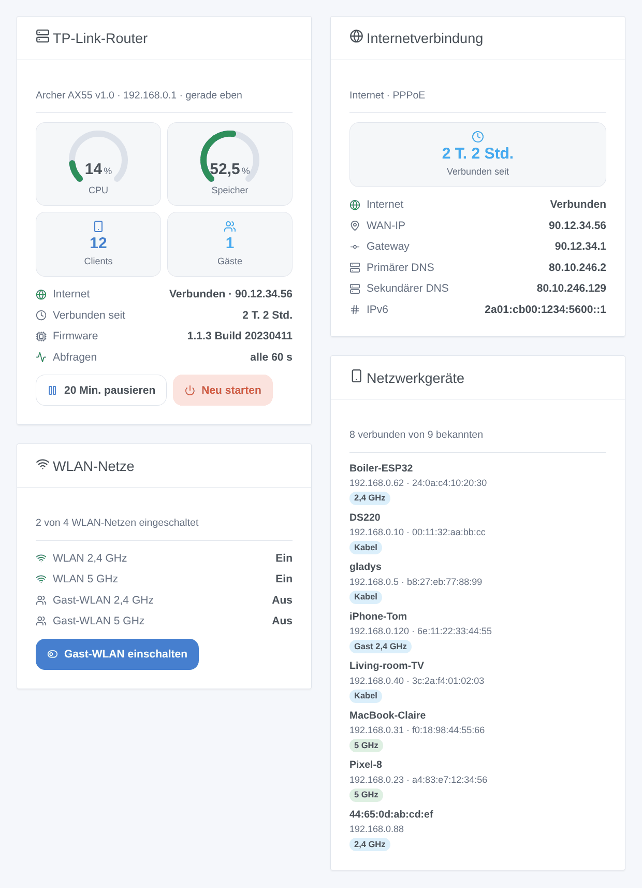

# Gladys TP-Link / Mercusys Router

[English](README.md) · [Français](README.fr.md) · **Deutsch** · [Español](README.es.md)

[](LICENSE)
[](https://github.com/William-De71/gladys-tplink-router/releases)
[](https://github.com/William-De71/gladys-tplink-router/actions/workflows/release.yml)
[](https://gladysassistant.com)


Externe [Gladys Assistant](https://gladysassistant.com)-Integration für **TP-Link- und Mercusys-Router** (Archer- und Mercusys-Router mit der aktuellen Weboberfläche): die Internetverbindung, die WLAN-Netze und das Gast-WLAN, die in Ihrem Netzwerk anwesenden Geräte, Szenen und Dashboard-Widgets. Alles läuft über die Weboberfläche des Routers in Ihrem lokalen Netzwerk, mit seinem lokalen Passwort: keine Cloud.

Benutzerdokumentation: [English](docs/en.md) · [Français](docs/fr.md) · [Deutsch](docs/de.md) · [Español](docs/es.md).

> Community-Integration, weder mit TP-Link Systems Inc. noch mit Mercusys verbunden oder von ihnen unterstützt.

## Funktionen

- Gerät **Router**: CPU- und Speicherauslastung, Internetstatus, WAN-IP-Adresse, Verbindungsdauer, verbundene Clients (alle, WLAN, Kabel, Gäste), Firmware-Version.
- Ein **Schalter je WLAN-Netz** (Haupt-, Gast- und IoT-WLAN, je Band): das Gast-WLAN einschalten, wenn Besuch kommt, per Szene oder Widget-Schaltfläche.
- **Anwesenheit** der Geräte Ihres Netzwerks aus der Client-Liste des Routers, mit Abwesenheitsverzögerung (wie der Device Tracker von Home Assistant).
- Eine **Pause** der Abfragen, um die Weboberfläche des Routers zu nutzen (sie lässt nur einen Administrator gleichzeitig zu).
- **4 Szenen-Auslöser**, **3 Szenen-Aktionen** und **4 Dashboard-Widgets** (unten).
- Überall vier Sprachen: Englisch, Französisch, Deutsch, Spanisch.

## Funktionsweise





Vom Scan bis zum Befehl:



Die Weboberfläche verschlüsselt ihre Anfragen: das Passwort mit dem RSA-Schlüssel der Anmeldeseite, jede Anfrage mit AES-128-CBC und einer RSA- (oder HMAC-)Signatur. Je nach Firmware gibt es vier Varianten (die klassische, Archer AX72, die „SG / CE RED“-zertifizierten Modelle wie Archer BE3600 und die reine RSA-Firmware 1.11+); die Integration findet die richtige und merkt sie sich. Der Client ist eine neue JavaScript-Implementierung dieses Protokolls, geschrieben nach dem Studium der Python-Bibliothek [tplinkrouterc6u](https://github.com/AlexandrErohin/TP-Link-Archer-C6U) (die Bibliothek der Home-Assistant-Integration „TP-Link Router“), deren Code nicht übernommen wurde. Die anderen Weboberflächen von TP-Link (Deco, 4G/5G-Modelle Archer MR / TL-MR / EX / VR, ältere Router) werden noch nicht unterstützt.

### Übertragung

`transports: ["local"]`: Die Integration spricht nur mit der Weboberfläche des Routers, über HTTP oder HTTPS in Ihrem Netzwerk. Bei HTTPS wird das Zertifikat geprüft, wenn Sie „Zertifikat prüfen“ ankreuzen (der Router wird mit einem selbstsignierten ausgeliefert). Keine Daten verlassen Ihr Netzwerk.

## Geräte und Funktionen

| Gerät          | Funktionen (Kategorie / Typ)                                                                                                                                                                            |
| -------------- | ------------------------------------------------------------------------------------------------------------------------------------------------------------------------------------------------------- |
| TP-Link-Router | CPU, Speicher (`level-sensor` %), Internet und WAN-IP (`text`), Internet verbunden seit (`duration`, Stunden), Clients, WLAN-Clients, Kabel-Clients, Gast-Clients (`counter-sensor`), Firmware (`text`) |
| WLAN-Netz      | WLAN-Netz (`switch` / `binary`, ein Befehl)                                                                                                                                                             |
| Netzwerkgerät  | Anwesenheit (`presence-sensor` / `push`, 1 jede Minute, solange anwesend, 0, sobald weg)                                                                                                                |

Externe IDs beruhen auf stabilen Kennungen: `main` für den Router, Netz und Band (`host_2g`, `guest_5g`, `iot_6g`) für ein WLAN-Netz, die MAC-Adresse für einen Client. CPU, Speicher und Verbindungsdauer werden erst angeboten, wenn der Router sie meldet.

## Szenen-Auslöser, Aktionen und Widgets



**Widgets**: TP-Link-Router (CPU- und Speicheranzeige, Clients, Gäste, Internet, Verbindungsdauer, Firmware, Abfragen, Schaltflächen „Pause“ und „Neu starten“), Internetverbindung (Verbindungsdauer, Verbindung, WAN-Adresse, Gateway, DNS, IPv6), WLAN-Netze (jedes Netz und sein Zustand, eine Schaltfläche für das Gast-WLAN und eine für das IoT-WLAN), Netzwerkgeräte (verbunden, gegangen oder alle, mit ihrer Verbindung).

**Auslöser**: Internet weg oder zurück, öffentliche IP-Adresse geändert, Gerät gekommen oder gegangen, neues Gerät im Netzwerk (einmal je MAC-Adresse, in `/data` gespeichert; Filter auf WLAN oder Kabel und auf Haupt-, Gast- oder IoT-Netz).

**Aktionen**: Status lesen, Haupt-, Gast- oder IoT-WLAN ein- oder ausschalten (ein Band oder alle), neu starten.

Beispiele:

- Wenn Besuch kommt (eine Taste, ein Kalendereintrag) → das Gast-WLAN einschalten; um Mitternacht → wieder ausschalten.
- Wenn sich die öffentliche IP-Adresse ändert → sie an den Administrator senden.
- Wenn das Telefon eines Kindes im Netzwerk ankommt → das Flurlicht einschalten und eine Nachricht senden.

Die Integration hat keinen Auslöser „Router neu gestartet“ oder „Update verfügbar“: Die Weboberfläche liefert weder die Betriebszeit des Routers noch das Ergebnis einer Update-Suche in einer Form, die die Integration zuverlässig lesen kann.

## Voraussetzungen

- Gladys Assistant **5.1.0** oder neuer (Widgets und Szenen): Ältere Instanzen können die Integration nicht installieren.
- Ein TP-Link- oder Mercusys-Router, dessen Weboberfläche `/webpages/index.html` zeigt, im Router-Modus, und sein lokales Passwort (keine TP-Link-ID).

## Installation

- **Aus dem Store**: Integrationen → TP-Link / Mercusys Router → Installieren.
- **Über die Repository-URL**: Integrationen → externe Integration → `https://github.com/William-De71/gladys-tplink-router`.
- **Entwicklermodus**: `npm start` mit den von Gladys gelieferten Variablen starten (siehe Entwicklung).

## Konfiguration

| Feld                      | Standard    | Bedeutung                                                 |
| ------------------------- | ----------- | --------------------------------------------------------- |
| Adresse des Routers       | —           | `192.168.0.1` (http) oder `https://192.168.0.1` mit HTTPS |
| Lokales Passwort          | —           | Das Passwort der Weboberfläche (ein `secret`)             |
| Benutzername              | `admin`     | `user` bei einigen EX-Modellen                            |
| Zertifikat prüfen         | aus         | Nur HTTPS: mit einem gültigen Zertifikat ankreuzen        |
| Leseintervall             | 60 s        | 30 bis 600 s                                              |
| Pausendauer               | 20 Min.     | 5 bis 120 Min.                                            |
| Angebotene Netzwerkgeräte | mit Namen   | mit Namen, alle, keine                                    |
| Abwesenheitsverzögerung   | 5 Min.      | 1 bis 60 Min.                                             |
| Sprache der Texte         | automatisch | Namen, Zustände und Szenen-Zusammenfassungen              |

## Verwendung

1. Die Konfiguration ausfüllen, dann auf **Verbindung testen** klicken.
2. **Erkennen**, dann den Router, die WLAN-Netze und die gewünschten Netzwerkgeräte hinzufügen.
3. Die Widgets zu einem Dashboard hinzufügen und Szenen mit den Auslösern und Aktionen erstellen.
4. Vor dem Öffnen der Weboberfläche des Routers im Router-Widget auf **Pause** drücken.

## Entwicklung

```bash
npm install
npm test                       # node --test, berührt nie das Netzwerk
npm run lint                   # ESLint
npm run format:check           # Prettier
npx github:GladysAssistant/integration-store . --skip-image-check
scripts/build-cover.sh         # cover.jpg aus docs/assets/cover.svg
docs/illustrations/render.sh   # docs/assets/widgets.<sprache>.png
```

Lokal liest das SDK `GLADYS_HOST_API_URL`, `GLADYS_INTEGRATION_TOKEN` und `GLADYS_INTEGRATION_SELECTOR` (von Gladys im Entwicklermodus geliefert). `DEBUG=gladys-integration-sdk` zeigt die Protokolle des SDK.

Die Tests decken die Verschlüsselung ab (RSA PKCS#1 v1.5 und OAEP mit 512- bis 2048-Bit-Schlüsseln, AES), den Router-Client gegen einen falschen Router, der die Serverseite der vier Anmeldevarianten umsetzt (falsches Passwort, Sperre, nicht unterstützte Firmware, Sitzungen, die sich nie überschneiden), das Lesen echter Router-Antworten, die Übergänge und die Anwesenheit, die Geräte (die vom Erkennungsbildschirm verlangten Felder), die Widgets (`validateWidgetContent`), die Szenen-Ereignisse und -Ausgaben, das Manifest, die vier Sprachen, das Release-Skript und die ganze Integration gegen das falsche Gladys des SDK. `test/structure.test.js` friert alle Schlüssel ein, die Benutzer speichern. Der falsche Router wurde auch mit der Bibliothek tplinkrouterc6u selbst geprüft: Ihre vier Clients melden sich an ihm an, lesen und schreiben.

## Release-Prozess


Jeder Merge auf `main` startet die CI und berechnet dann die Version aus den [Conventional Commits](https://www.conventionalcommits.org/de/) seit dem letzten Tag: `feat` → Minor, `fix` / `perf` → Patch, `!` oder `BREAKING CHANGE` → Major (ein Minor unter 1.0.0); `docs`, `chore`, `ci`, `test`, `style`, `refactor`, `build` allein veröffentlichen nichts. Der Changelog-Abschnitt wird erzeugt, der Tag gepusht, das Multi-Architektur-Image gebaut, dann erhält `main` den Release-Commit, das GitHub Release wird erstellt und ein letzter Job prüft das öffentliche Image, den Validator des Stores und das Topic.

- Der Titel des Pull Requests wird zum Squash-Commit und dann zur Changelog-Zeile: Schreiben Sie ihn auf Englisch, für den Benutzer (`pr-title.yml` prüft ihn). `CHANGELOG.md` nie von Hand bearbeiten.
- 1.0.0 ist eine Entscheidung: Actions → Release → Run workflow mit `release-as: 1.0.0`. `dry-run` zeigt Version und Notizen, ohne etwas zu veröffentlichen.
- **Geschützter Branch**: Das Release pusht seinen Commit mit `GITHUB_TOKEN` auf `main`. Mit einem Ruleset, das Pull Requests oder Status Checks auf `main` verlangt, GitHub Actions zur Bypass-Liste hinzufügen (oder über eine GitHub App pushen), sonst schlägt der Veröffentlichungs-Job mit Anweisungen fehl.
- Nach dem ersten Release das Paket auf `ghcr.io` öffentlich machen (Package settings → Change visibility), sonst kann Gladys es nicht laden.

## Fehlerbehebung

Siehe [docs/de.md](docs/de.md#fehlerbehebung). Melden Sie Probleme mit den Versionen von Gladys und der Integration, Modell, Hardwareversion und Firmware des Routers und den Protokollen der Integration.

## Mitwirken

Issues und Pull Requests sind willkommen. Vor einem Pull Request `npm run format:check && npm run lint && npm test` ausführen und alle externen IDs und gespeicherten Schlüssel unverändert lassen (siehe [CLAUDE.md](CLAUDE.md)). Ein Mitschnitt der Anmeldung eines noch nicht unterstützten Modells hilft sehr.

## Sicherheit

Siehe [SECURITY.md](SECURITY.md): Schwachstellen bitte vertraulich melden. Das Passwort ist ein `secret`-Feld, wird nie protokolliert, nie im Klartext gesendet (es wird wie von der Weboberfläche RSA-verschlüsselt) und nie in eine URL geschrieben; nach einem abgelehnten Passwort versucht es die Integration 15 Minuten lang nicht erneut, damit der Router die Anmeldung nicht sperrt. Der Status des Routers enthält auch die WLAN-Schlüssel: Die Integration speichert und protokolliert sie nie.

## Kommende Screenshots

Die Bilder oben sind Illustrationen, keine Screenshots. Echte Screenshots kommen nach `docs/assets/screenshots/` (PNG, 1280 × 800): `configuration.png`, `discovery.png`, `devices.png`, `scene.png`.

## Lizenz

[Apache-Lizenz 2.0](LICENSE) — siehe auch [NOTICE](NOTICE). TP-Link, Archer, Deco und Mercusys sind Marken ihrer Inhaber; diese Community-Integration ist nicht mit ihnen verbunden. Dank an die Dokumentation und das SDK von Gladys sowie an die Bibliothek tplinkrouterc6u für die Beschreibung des Protokolls.
