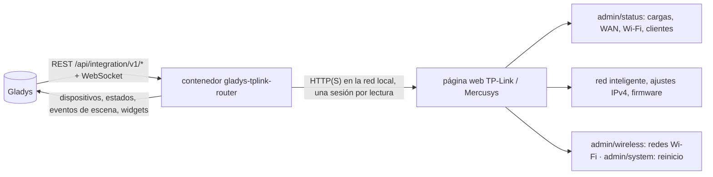
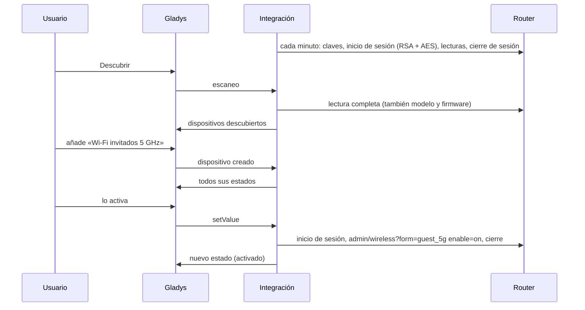
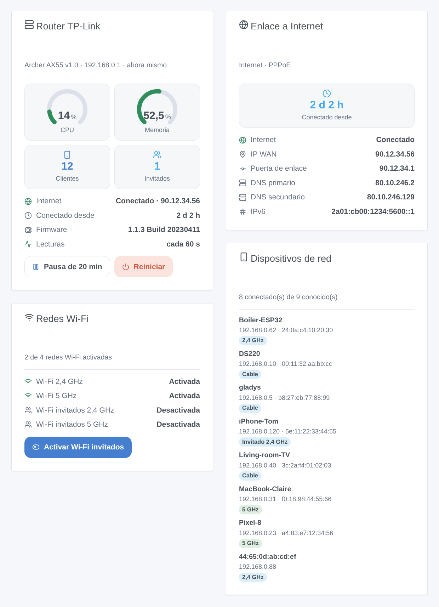

# Gladys TP-Link / Mercusys Router

[English](README.md) · [Français](README.fr.md) · [Deutsch](README.de.md) · **Español**

[](LICENSE)
[](https://github.com/William-De71/gladys-tplink-router/releases)
[](https://github.com/William-De71/gladys-tplink-router/actions/workflows/release.yml)
[](https://gladysassistant.com)


Integración externa de [Gladys Assistant](https://gladysassistant.com) para los **routers TP-Link y Mercusys** (routers Archer y Mercusys con la página web actual): el enlace a Internet, las redes Wi-Fi y el Wi-Fi de invitados, los dispositivos presentes en su red, escenas y widgets de panel. Todo pasa por la página web del router en su red local, con su contraseña local: sin nube.

Documentación de usuario: [English](docs/en.md) · [Français](docs/fr.md) · [Deutsch](docs/de.md) · [Español](docs/es.md).

> Integración comunitaria, sin relación con TP-Link Systems Inc. ni con Mercusys, y no respaldada por ellos.

## Funciones

- Dispositivo **router**: uso de CPU y memoria, estado de Internet, dirección IP WAN, tiempo conectado, clientes conectados (todos, Wi-Fi, por cable, invitados), versión del firmware.
- Un **interruptor por red Wi-Fi** (Wi-Fi principal, de invitados e IoT, por banda): active el Wi-Fi de invitados cuando llegan visitas, desde una escena o un botón de widget.
- **Presencia** de los dispositivos de su red, según la lista de clientes del router, con un retardo de ausencia (como el device tracker de Home Assistant).
- Una **pausa** de las lecturas, para usar la página web del router (admite un solo administrador a la vez).
- **4 disparadores de escena**, **3 acciones de escena** y **4 widgets de panel** (abajo).
- Cuatro idiomas en todas partes: inglés, francés, alemán, español.

## Funcionamiento




Del escaneo a una orden:



La página web cifra sus peticiones: la contraseña con la clave RSA de la página de inicio de sesión, cada petición con AES-128-CBC y una firma RSA (o HMAC). Existen cuatro variantes según el firmware (la clásica, el Archer AX72, los modelos certificados «SG / CE RED» como el Archer BE3600 y los firmwares 1.11+ solo RSA); la integración encuentra la buena y la recuerda. El cliente es una nueva implementación en JavaScript de este protocolo, escrita tras estudiar la biblioteca Python [tplinkrouterc6u](https://github.com/AlexandrErohin/TP-Link-Archer-C6U) (la de la integración «TP-Link Router» de Home Assistant), cuyo código no se ha copiado. Las demás páginas web de TP-Link (Deco, modelos 4G/5G Archer MR / TL-MR / EX / VR, routers antiguos) aún no se admiten.

### Transporte

`transports: ["local"]`: la integración solo habla con la página web del router, por HTTP o HTTPS en su red. Con HTTPS, el certificado se verifica si marca «Verificar el certificado» (el router viene con uno autofirmado). Ningún dato sale de su red.

## Dispositivos y funciones

| Dispositivo        | Funciones (categoría / tipo)                                                                                                                                                                    |
| ------------------ | ----------------------------------------------------------------------------------------------------------------------------------------------------------------------------------------------- |
| Router TP-Link     | CPU, memoria (`level-sensor` %), Internet e IP WAN (`text`), Internet conectado desde (`duration`, horas), clientes, clientes Wi-Fi, por cable, invitados (`counter-sensor`), firmware (`text`) |
| Red Wi-Fi          | Red Wi-Fi (`switch` / `binary`, una orden)                                                                                                                                                      |
| Dispositivo de red | Presencia (`presence-sensor` / `push`, 1 cada minuto mientras está presente, 0 cuando se ha ido)                                                                                                |

Los identificadores externos se basan en identificadores estables: `main` para el router, la red y la banda (`host_2g`, `guest_5g`, `iot_6g`) para una red Wi-Fi, la dirección MAC para un cliente. La CPU, la memoria y el tiempo conectado solo se ofrecen cuando el router los indica.

## Disparadores, acciones de escena y widgets



**Widgets**: Router TP-Link (indicadores de CPU y memoria, clientes, invitados, Internet, tiempo conectado, firmware, lecturas, botones «pausa» y «reiniciar»), Enlace a Internet (tiempo conectado, enlace, dirección WAN, puerta de enlace, DNS, IPv6), Redes Wi-Fi (cada red y su estado, un botón para el Wi-Fi de invitados y otro para el Wi-Fi IoT), Dispositivos de red (conectados, idos o todos, con su conexión).

**Disparadores**: Internet caído o restablecido, IP pública cambiada, dispositivo llegó o se fue, nuevo dispositivo en la red (una vez por dirección MAC, recordada en `/data`; filtros Wi-Fi o cable y red principal, de invitados o IoT).

**Acciones**: leer el estado, activar o apagar el Wi-Fi principal, de invitados o IoT (una banda o todas), reiniciar.

Ejemplos:

- Cuando llega una visita (un botón, un evento de calendario) → activar el Wi-Fi de invitados; a medianoche → apagarlo.
- Cuando cambia la IP pública → enviarla al administrador.
- Cuando el teléfono de un niño llega a la red → encender la luz de la entrada y enviar un mensaje.

La integración no tiene disparador «router reiniciado» ni «actualización disponible»: la página web no da ni el tiempo en marcha del router ni el resultado de una búsqueda de actualización de forma que la integración pueda leerlos con fiabilidad.

## Requisitos

- Gladys Assistant **5.1.0** o posterior (widgets y escenas): las instancias más antiguas no pueden instalar la integración.
- Un router TP-Link o Mercusys cuya página web muestre `/webpages/index.html`, en modo router, y su contraseña local (no un TP-Link ID).

## Instalación

- **Desde la tienda**: Integraciones → TP-Link / Mercusys Router → Instalar.
- **Desde la URL del repositorio**: Integraciones → integración externa → `https://github.com/William-De71/gladys-tplink-router`.
- **Modo desarrollador**: ejecute `npm start` con las variables que da Gladys (ver Desarrollo).

## Configuración

| Campo                         | Por defecto | Significado                                             |
| ----------------------------- | ----------- | ------------------------------------------------------- |
| Dirección del router          | —           | `192.168.0.1` (http), o `https://192.168.0.1` con HTTPS |
| Contraseña local              | —           | La contraseña de la página web (un `secret`)            |
| Nombre de usuario             | `admin`     | `user` en algunos modelos EX                            |
| Verificar el certificado      | no          | Solo HTTPS: márquelo con un certificado válido          |
| Intervalo de lectura          | 60 s        | 30 a 600 s                                              |
| Duración de la pausa          | 20 min      | 5 a 120 min                                             |
| Dispositivos de red ofrecidos | con nombre  | con nombre, todos, ninguno                              |
| Retardo de ausencia           | 5 min       | 1 a 60 min                                              |
| Idioma de los textos          | automático  | Nombres, estados y resúmenes de escenas                 |

## Uso

1. Rellene la configuración y haga clic en **Probar la conexión**.
2. **Descubrir**, y luego añada el router, las redes Wi-Fi y los dispositivos de red que quiera.
3. Añada los widgets a un panel y cree escenas con los disparadores y las acciones.
4. Antes de abrir la página web del router, pulse **Pausa** en el widget del router.

## Desarrollo

```bash
npm install
npm test                       # node --test, nunca toca la red
npm run lint                   # ESLint
npm run format:check           # Prettier
npx github:GladysAssistant/integration-store . --skip-image-check
scripts/build-cover.sh         # cover.jpg desde docs/assets/cover.svg
docs/illustrations/render.sh   # docs/assets/widgets.<idioma>.png
```

En local, el SDK lee `GLADYS_HOST_API_URL`, `GLADYS_INTEGRATION_TOKEN` y `GLADYS_INTEGRATION_SELECTOR` (que da Gladys en modo desarrollador). `DEBUG=gladys-integration-sdk` muestra los registros del SDK.

Las pruebas cubren el cifrado (RSA PKCS#1 v1.5 y OAEP con claves de 512 a 2048 bits, AES), el cliente del router frente a un router falso que implementa el lado servidor de las cuatro variantes de inicio de sesión (contraseña errónea, bloqueo, firmware no admitido, sesiones que nunca se solapan), la lectura de respuestas reales de routers, las transiciones y la presencia, los dispositivos (los campos que exige la pantalla de descubrimiento), los widgets (`validateWidgetContent`), los eventos y salidas de escena, el manifiesto, los cuatro idiomas, el script de release y toda la integración frente al Gladys falso del SDK. `test/structure.test.js` congela todas las claves que guardan los usuarios. El router falso también se comprobó con la propia biblioteca tplinkrouterc6u: sus cuatro clientes inician sesión en él, leen y escriben.

## Proceso de release


Cada fusión en `main` lanza la CI y luego calcula la versión a partir de los [Conventional Commits](https://www.conventionalcommits.org/es/) desde la última etiqueta: `feat` → menor, `fix` / `perf` → parche, `!` o `BREAKING CHANGE` → mayor (una menor por debajo de 1.0.0); `docs`, `chore`, `ci`, `test`, `style`, `refactor`, `build` solos no publican nada. Se genera la sección del changelog, se sube la etiqueta, se construye la imagen multiarquitectura, luego `main` recibe el commit de release, se crea la GitHub Release y un último job comprueba la imagen pública, el validador de la tienda y el topic.

- El título de la pull request se convierte en el commit squash y luego en la línea del changelog: escríbalo en inglés, para el usuario (`pr-title.yml` lo comprueba). No edite nunca `CHANGELOG.md` a mano.
- La 1.0.0 es una decisión: Actions → Release → Run workflow con `release-as: 1.0.0`. `dry-run` muestra la versión y las notas sin publicar nada.
- **Rama protegida**: la release sube su commit a `main` con `GITHUB_TOKEN`. Con un ruleset que exija pull requests o status checks en `main`, añada GitHub Actions a su lista de omisión (o suba mediante una GitHub App); si no, el job de publicación falla con instrucciones.
- Tras la primera release, haga público el paquete de `ghcr.io` (Package settings → Change visibility), o Gladys no podrá descargarlo.

## Solución de problemas

Ver [docs/es.md](docs/es.md#solución-de-problemas). Informe de los problemas con las versiones de Gladys y de la integración, el modelo, la versión de hardware y el firmware del router, y los registros de la integración.

## Contribuir

Las issues y pull requests son bienvenidas. Ejecute `npm run format:check && npm run lint && npm test` antes de abrir una pull request, y mantenga sin cambios todos los identificadores externos y claves guardadas (ver [CLAUDE.md](CLAUDE.md)). Una captura del inicio de sesión de un modelo aún no admitido ayuda mucho.

## Seguridad

Ver [SECURITY.md](SECURITY.md): informe de las vulnerabilidades en privado. La contraseña es un campo `secret`, nunca registrado, nunca enviado en claro (se cifra en RSA como hace la página web) ni puesto en una URL; la integración deja de intentarlo durante 15 minutos tras una contraseña rechazada, para que el router no bloquee el inicio de sesión. El estado del router también contiene las claves Wi-Fi: la integración nunca las guarda ni las registra.

## Capturas por venir

Las imágenes de arriba son ilustraciones, no capturas de pantalla. Las capturas reales irán en `docs/assets/screenshots/` (PNG, 1280 × 800): `configuration.png`, `discovery.png`, `devices.png`, `scene.png`.

## Licencia

[Licencia Apache 2.0](LICENSE) — ver también [NOTICE](NOTICE). TP-Link, Archer, Deco y Mercusys son marcas de sus propietarios; esta integración comunitaria no tiene relación con ellos. Gracias a la documentación y al SDK de Gladys, y a la biblioteca tplinkrouterc6u por la descripción del protocolo.
