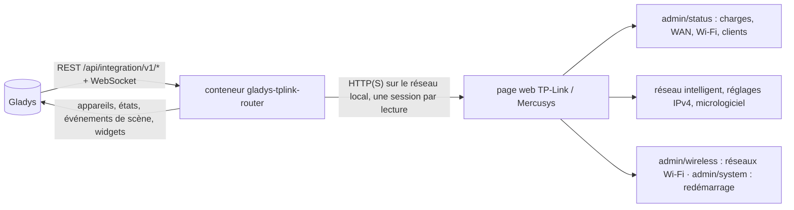
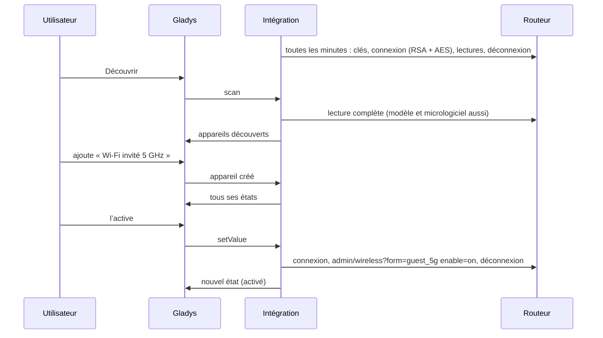
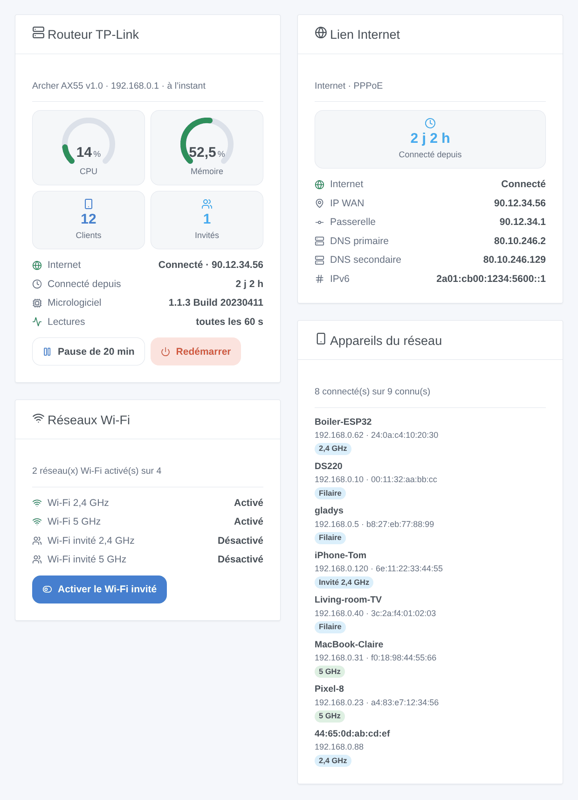

# Gladys TP-Link / Mercusys Router

[English](README.md) · **Français** · [Deutsch](README.de.md) · [Español](README.es.md)

[](LICENSE)
[](https://github.com/William-De71/gladys-tplink-router/releases)
[](https://github.com/William-De71/gladys-tplink-router/actions/workflows/release.yml)
[](https://gladysassistant.com)


Intégration externe [Gladys Assistant](https://gladysassistant.com) pour les **routeurs TP-Link et Mercusys** (routeurs Archer et Mercusys dotés de la page web actuelle) : le lien Internet, les réseaux Wi-Fi et le Wi-Fi invité, les appareils présents sur votre réseau, des scènes et des widgets de tableau de bord. Tout passe par la page web du routeur sur votre réseau local, avec son mot de passe local : aucun cloud.

Documentation utilisateur : [English](docs/en.md) · [Français](docs/fr.md) · [Deutsch](docs/de.md) · [Español](docs/es.md).

> Intégration communautaire, sans lien avec TP-Link Systems Inc. ni Mercusys, et non approuvée par eux.

## Fonctionnalités

- Appareil **routeur** : utilisation du CPU et de la mémoire, état d’Internet, adresse IP WAN, durée de connexion, clients connectés (tous, Wi-Fi, filaires, invités), version du micrologiciel.
- Un **interrupteur par réseau Wi-Fi** (Wi-Fi principal, invité et IoT, par bande) : activez le Wi-Fi invité quand des visiteurs arrivent, depuis une scène ou un bouton de widget.
- **Présence** des appareils de votre réseau, d’après la liste des clients du routeur, avec un délai d’absence (comme le suivi d’appareils de Home Assistant).
- Une **pause** des lectures, pour utiliser la page web du routeur (elle n’admet qu’un administrateur à la fois).
- **4 déclencheurs de scène**, **3 actions de scène** et **4 widgets de tableau de bord** (ci-dessous).
- Quatre langues partout : anglais, français, allemand, espagnol.

## Fonctionnement




Du scan à une commande :



La page web chiffre ses requêtes : le mot de passe avec la clé RSA de la page de connexion, chaque requête en AES-128-CBC avec une signature RSA (ou HMAC). Quatre variantes existent selon le micrologiciel (la classique, l’Archer AX72, les modèles certifiés « SG / CE RED » comme l’Archer BE3600, et les micrologiciels 1.11+ en RSA seul) ; l’intégration trouve la bonne et la mémorise. Le client est une nouvelle implémentation JavaScript de ce protocole, écrite après étude de la bibliothèque Python [tplinkrouterc6u](https://github.com/AlexandrErohin/TP-Link-Archer-C6U) (celle de l’intégration Home Assistant « TP-Link Router »), dont le code n’a pas été copié. Les autres pages web de TP-Link (Deco, modèles 4G/5G Archer MR / TL-MR / EX / VR, anciens routeurs) ne sont pas encore prises en charge.

### Transport

`transports: ["local"]` : l’intégration ne parle qu’à la page web du routeur, en HTTP ou HTTPS sur votre réseau. En HTTPS, le certificat est vérifié si vous cochez « Vérifier le certificat » (le routeur est livré avec un certificat auto-signé). Aucune donnée ne quitte votre réseau.

## Appareils et fonctionnalités

| Appareil           | Fonctionnalités (catégorie / type)                                                                                                                                                                                |
| ------------------ | ----------------------------------------------------------------------------------------------------------------------------------------------------------------------------------------------------------------- |
| Routeur TP-Link    | CPU, mémoire (`level-sensor` %), Internet et IP WAN (`text`), Internet connecté depuis (`duration`, heures), clients, clients Wi-Fi, clients filaires, clients invités (`counter-sensor`), micrologiciel (`text`) |
| Réseau Wi-Fi       | Réseau Wi-Fi (`switch` / `binary`, une commande)                                                                                                                                                                  |
| Appareil du réseau | Présence (`presence-sensor` / `push`, 1 chaque minute tant qu’il est présent, 0 une fois parti)                                                                                                                   |

Les identifiants externes reposent sur des identifiants stables : `main` pour le routeur, le réseau et la bande (`host_2g`, `guest_5g`, `iot_6g`) pour un réseau Wi-Fi, l’adresse MAC pour un client. Le CPU, la mémoire et la durée de connexion ne sont proposés qu’une fois indiqués par le routeur.

## Déclencheurs, actions de scène et widgets



**Widgets** : Routeur TP-Link (jauges CPU et mémoire, clients, invités, Internet, durée de connexion, micrologiciel, lectures, boutons « pause » et « redémarrer »), Lien Internet (durée de connexion, lien, adresse WAN, passerelle, DNS, IPv6), Réseaux Wi-Fi (chaque réseau et son état, un bouton pour le Wi-Fi invité et un pour le Wi-Fi IoT), Appareils du réseau (connectés, partis ou tous, avec leur connexion).

**Déclencheurs** : Internet coupé ou rétabli, adresse IP publique changée, appareil arrivé ou parti, nouvel appareil sur le réseau (une fois par adresse MAC, mémorisée dans `/data` ; filtres Wi-Fi ou filaire et réseau principal, invité ou IoT).

**Actions** : lire l’état, activer ou couper le Wi-Fi principal, invité ou IoT (une bande ou toutes), redémarrer.

Exemples :

- Quand un visiteur arrive (un bouton, un événement d’agenda) → activer le Wi-Fi invité ; à minuit → le couper.
- Quand l’adresse IP publique change → l’envoyer à l’administrateur.
- Quand le téléphone d’un enfant arrive sur le réseau → allumer la lumière de l’entrée et envoyer un message.

L’intégration n’a pas de déclencheur « routeur redémarré » ni « mise à jour disponible » : la page web ne donne ni la durée de fonctionnement du routeur ni le résultat d’une recherche de mise à jour sous une forme que l’intégration peut lire de façon fiable.

## Prérequis

- Gladys Assistant **5.3.0** ou plus récent (widgets et scènes ; mots-clés et pays du catalogue de Gladys 5.3) : les instances plus anciennes ne peuvent pas installer l’intégration.
- Un routeur TP-Link ou Mercusys dont la page web affiche `/webpages/index.html`, en mode routeur, et son mot de passe local (pas un TP-Link ID).

## Installation

- **Depuis le store** : Intégrations → TP-Link / Mercusys Router → Installer.
- **Depuis l’URL du dépôt** : Intégrations → intégration externe → `https://github.com/William-De71/gladys-tplink-router`.
- **Mode développeur** : lancez `npm start` avec les variables fournies par Gladys (voir Développement).

## Configuration

| Champ                        | Défaut      | Signification                                                |
| ---------------------------- | ----------- | ------------------------------------------------------------ |
| Adresse du routeur           | —           | `192.168.0.1` (http), ou `https://192.168.0.1` avec le HTTPS |
| Mot de passe local           | —           | Le mot de passe de la page web (un `secret`)                 |
| Nom d’utilisateur            | `admin`     | `user` sur certains modèles EX                               |
| Vérifier le certificat       | non         | HTTPS seulement : cochez-le avec un certificat valide        |
| Intervalle de lecture        | 60 s        | 30 à 600 s                                                   |
| Durée de la pause            | 20 min      | 5 à 120 min                                                  |
| Appareils du réseau proposés | ceux nommés | ceux nommés, tous, aucun                                     |
| Délai d’absence              | 5 min       | 1 à 60 min                                                   |
| Langue des textes            | automatique | Noms, états et résumés des scènes                            |

## Utilisation

1. Remplissez la configuration, puis cliquez sur **Tester la connexion**.
2. **Découvrir**, puis ajoutez le routeur, les réseaux Wi-Fi et les appareils du réseau voulus.
3. Ajoutez les widgets à un tableau de bord, et créez des scènes avec les déclencheurs et les actions.
4. Avant d’ouvrir la page web du routeur, appuyez sur **Pause** dans le widget du routeur.

## Développement

```bash
npm install
npm test                       # node --test, ne touche jamais le réseau
npm run lint                   # ESLint
npm run format:check           # Prettier
npx github:GladysAssistant/integration-store . --skip-image-check
scripts/build-cover.sh         # cover.jpg depuis docs/assets/cover.svg
docs/illustrations/render.sh   # docs/assets/widgets.<langue>.png
```

En local, le SDK lit `GLADYS_HOST_API_URL`, `GLADYS_INTEGRATION_TOKEN` et `GLADYS_INTEGRATION_SELECTOR` (fournis par Gladys en mode développeur). `DEBUG=gladys-integration-sdk` affiche les journaux du SDK.

Les tests couvrent le chiffrement (RSA PKCS#1 v1.5 et OAEP sur des clés de 512 à 2048 bits, AES), le client du routeur face à un faux routeur qui implémente le côté serveur des quatre variantes de connexion (mauvais mot de passe, blocage, micrologiciel non pris en charge, sessions qui ne se chevauchent jamais), la lecture de réponses réelles de routeurs, les transitions et la présence, les appareils (les champs exigés par l’écran de découverte), les widgets (`validateWidgetContent`), les événements et sorties des scènes, le manifeste, les quatre langues, le script de release, et toute l’intégration face au faux Gladys du SDK. `test/structure.test.js` fige toutes les clés que les utilisateurs enregistrent. Le faux routeur a aussi été vérifié avec la bibliothèque tplinkrouterc6u elle-même : ses quatre clients s’y connectent, lisent et écrivent.

## Processus de release


Chaque fusion sur `main` lance la CI, puis calcule la version d’après les [Conventional Commits](https://www.conventionalcommits.org/fr/) depuis le dernier tag : `feat` → mineure, `fix` / `perf` → correctif, `!` ou `BREAKING CHANGE` → majeure (une mineure sous 1.0.0) ; `docs`, `chore`, `ci`, `test`, `style`, `refactor`, `build` seuls ne publient rien. La section du changelog est générée, le tag poussé, l’image multi-architecture construite, puis `main` reçoit le commit de release, la GitHub Release est créée et un dernier job vérifie l’image publique, le validateur du store et le topic.

- Le titre de la pull request devient le commit squash, puis la ligne du changelog : écrivez-le en anglais, pour l’utilisateur (`pr-title.yml` le vérifie). Ne modifiez jamais `CHANGELOG.md` à la main.
- La 1.0.0 est une décision : Actions → Release → Run workflow avec `release-as: 1.0.0`. `dry-run` affiche la version et les notes sans rien publier.
- **Branche protégée** : la release pousse son commit sur `main` avec `GITHUB_TOKEN`. Avec un ruleset qui impose des pull requests ou des status checks sur `main`, ajoutez GitHub Actions à sa liste de contournement (ou poussez via une GitHub App), sinon le job de publication échoue avec des instructions.
- Après la première release, rendez public le package `ghcr.io` (Package settings → Change visibility), sinon Gladys ne peut pas le télécharger.

## Dépannage

Voir [docs/fr.md](docs/fr.md#dépannage). Signalez les problèmes avec les versions de Gladys et de l’intégration, le modèle, la version matérielle et le micrologiciel du routeur, et les journaux de l’intégration.

## Contribuer

Issues et pull requests bienvenues. Lancez `npm run format:check && npm run lint && npm test` avant d’ouvrir une pull request, et gardez inchangés tous les identifiants externes et les clés enregistrées (voir [CLAUDE.md](CLAUDE.md)). Une capture de la connexion d’un modèle pas encore pris en charge aide beaucoup.

## Sécurité

Voir [SECURITY.md](SECURITY.md) : signalez les vulnérabilités en privé. Le mot de passe est un champ `secret`, jamais journalisé, jamais envoyé en clair (il est chiffré en RSA comme le fait la page web) ni mis dans une URL ; l’intégration cesse d’essayer pendant 15 minutes après un mot de passe refusé, pour que le routeur ne bloque pas la connexion. Le statut du routeur contient aussi les clés Wi-Fi : l’intégration ne les garde ni ne les journalise jamais.

## Captures à venir

Les images ci-dessus sont des illustrations, pas des captures d’écran. De vraies captures iront dans `docs/assets/screenshots/` (PNG, 1280 × 800) : `configuration.png`, `discovery.png`, `devices.png`, `scene.png`.

## Licence

[Licence Apache 2.0](LICENSE) — voir aussi [NOTICE](NOTICE). TP-Link, Archer, Deco et Mercusys sont des marques de leurs propriétaires ; cette intégration communautaire n’a aucun lien avec eux. Merci à la documentation et au SDK de Gladys, et à la bibliothèque tplinkrouterc6u pour la description du protocole.
