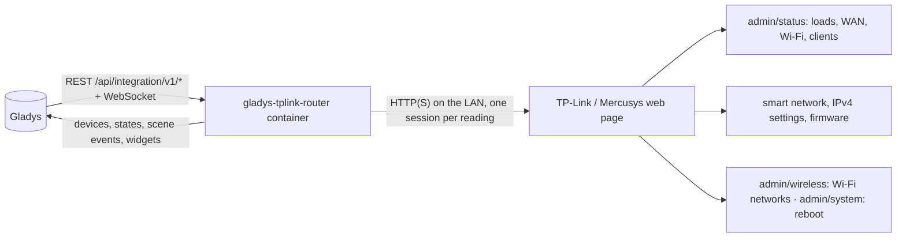
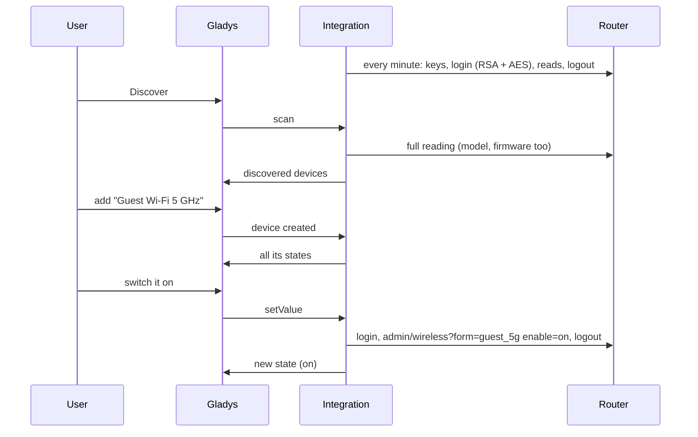
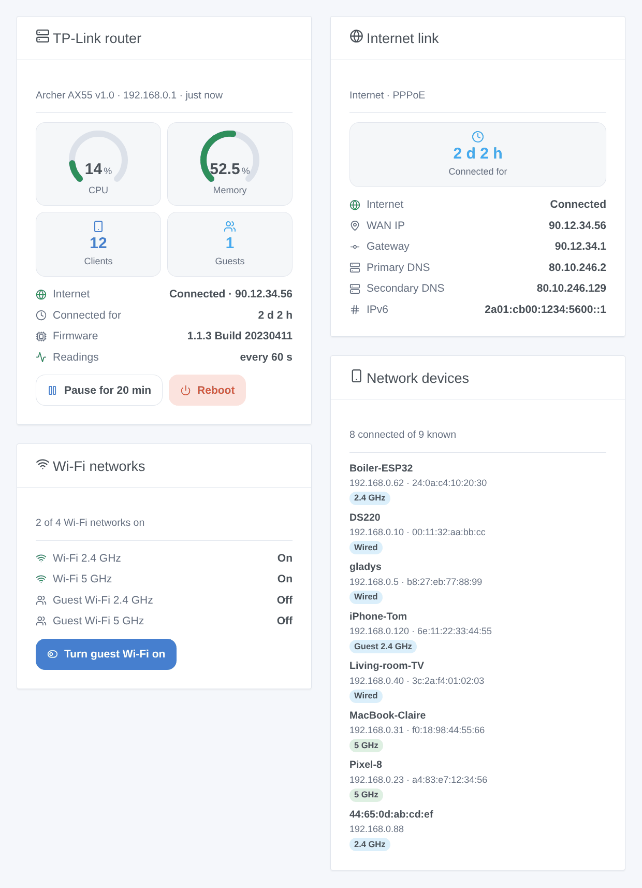

# Gladys TP-Link / Mercusys Router

**English** · [Français](README.fr.md) · [Deutsch](README.de.md) · [Español](README.es.md)

[](LICENSE)
[](https://github.com/William-De71/gladys-tplink-router/releases)
[](https://github.com/William-De71/gladys-tplink-router/actions/workflows/release.yml)
[](https://gladysassistant.com)


[Gladys Assistant](https://gladysassistant.com) external integration for **TP-Link and Mercusys routers** (Archer and Mercusys routers with the current web page): the internet link, the Wi-Fi networks and the guest Wi-Fi, the devices present on your network, scenes and dashboard widgets. Everything goes through the web page of the router on your local network, with its local password: no cloud.

User documentation: [English](docs/en.md) · [Français](docs/fr.md) · [Deutsch](docs/de.md) · [Español](docs/es.md).

> Community integration, not affiliated with nor endorsed by TP-Link Systems Inc. or Mercusys.

## Features

- **Router** device: CPU and memory usage, internet status, WAN IP address, time connected, connected clients (all, Wi-Fi, wired, guest), firmware version.
- A **switch per Wi-Fi network** (main, guest and IoT Wi-Fi, per band): turn the guest Wi-Fi on when visitors come, from a scene or a widget button.
- **Presence** of the devices of your network, from the client list of the router, with an absence delay (like the Home Assistant device tracker).
- A **pause** of the readings, to use the web page of the router (it admits one administrator at a time).
- **4 scene triggers**, **3 scene actions** and **4 dashboard widgets** (below).
- Four languages everywhere: English, French, German, Spanish.

## How it works




From the scan to a command:



The web page encrypts its requests: the password with the RSA key of the login page, each request with AES-128-CBC and an RSA (or HMAC) signature. Four variants exist by firmware (the classic one, Archer AX72, the "SG / CE RED" certified models such as Archer BE3600, and the RSA-only firmware 1.11+); the integration finds the right one and remembers it. The client is a new JavaScript implementation of this protocol, written after studying the [tplinkrouterc6u](https://github.com/AlexandrErohin/TP-Link-Archer-C6U) Python library (the library of the Home Assistant "TP-Link Router" integration), whose code was not copied. The other web pages of TP-Link (Deco, Archer MR / TL-MR / EX / VR 4G/5G models, older routers) are not supported yet.

### Transport

`transports: ["local"]`: the integration only talks to the web page of the router, over HTTP or HTTPS on your network. With HTTPS, the certificate is checked when you tick "Verify the certificate" (the router ships with a self-signed one). No data leaves your network.

## Devices and features

| Device         | Features (category / type)                                                                                                                                                                           |
| -------------- | ---------------------------------------------------------------------------------------------------------------------------------------------------------------------------------------------------- |
| TP-Link router | CPU, memory (`level-sensor` %), internet and WAN IP (`text`), internet connected for (`duration`, hours), clients, Wi-Fi clients, wired clients, guest clients (`counter-sensor`), firmware (`text`) |
| Wi-Fi network  | Wi-Fi network (`switch` / `binary`, a command)                                                                                                                                                       |
| Network device | Presence (`presence-sensor` / `push`, 1 every minute while present, 0 once gone)                                                                                                                     |

External ids rest on stable identifiers: `main` for the router, the network and band (`host_2g`, `guest_5g`, `iot_6g`) for a Wi-Fi network, the MAC address for a client. CPU, memory and the time connected are only offered once the router reports them.

## Scene triggers, actions and widgets



**Widgets**: TP-Link router (CPU and memory gauges, clients, guests, internet, time connected, firmware, readings, "pause" and "reboot" buttons), Internet link (time connected, link, WAN address, gateway, DNS, IPv6), Wi-Fi networks (each network and its state, a button for the guest Wi-Fi and one for the IoT Wi-Fi), Network devices (connected, gone or all, with their connection).

**Triggers**: internet down or back, public IP address changed, device arrived or left, new device on the network (once per MAC address, remembered in `/data`; filters on Wi-Fi or wired and on the main, guest or IoT network).

**Actions**: read the status, turn the main, guest or IoT Wi-Fi on or off (one band or all), reboot.

Examples:

- When a visitor arrives (a button, a calendar event) → turn the guest Wi-Fi on; at midnight → turn it off.
- When the public IP address changes → send it to the administrator.
- When the phone of a child arrives on the network → turn the hall light on and send a message.

The integration has no "router rebooted" nor "firmware update available" trigger: the web page gives neither the uptime of the router nor the result of a firmware check in a form the integration can read reliably.

## Requirements

- Gladys Assistant **5.3.0** or later (widgets and scenes; catalog keywords and countries of Gladys 5.3): older instances cannot install the integration.
- A TP-Link or Mercusys router whose web page shows `/webpages/index.html`, in router mode, and its local password (not a TP-Link ID).

## Installation

- **From the store**: Integrations → TP-Link / Mercusys Router → Install.
- **From the repository URL**: Integrations → external integration → `https://github.com/William-De71/gladys-tplink-router`.
- **Developer mode**: run `npm start` with the variables given by Gladys (see Development).

## Configuration

| Field                   | Default     | Meaning                                                   |
| ----------------------- | ----------- | --------------------------------------------------------- |
| Router address          | —           | `192.168.0.1` (http), or `https://192.168.0.1` with HTTPS |
| Local password          | —           | The password of the web page (a `secret`)                 |
| User name               | `admin`     | `user` on some EX models                                  |
| Verify the certificate  | off         | HTTPS only: tick it with a valid certificate              |
| Reading interval        | 60 s        | 30 to 600 s                                               |
| Pause length            | 20 min      | 5 to 120 min                                              |
| Network devices offered | with a name | with a name, all, none                                    |
| Absence delay           | 5 min       | 1 to 60 min                                               |
| Language of the texts   | automatic   | Names, states and scene summaries                         |

## Usage

1. Fill in the configuration, then click **Test the connection**.
2. **Discover**, then add the router, the Wi-Fi networks and the network devices you want.
3. Add the widgets to a dashboard, and build scenes with the triggers and actions.
4. Before opening the web page of the router, press **Pause** on the router widget.

## Development

```bash
npm install
npm test                       # node --test, never touches the network
npm run lint                   # ESLint
npm run format:check           # Prettier
npx github:GladysAssistant/integration-store . --skip-image-check
scripts/build-cover.sh         # cover.jpg from docs/assets/cover.svg
docs/illustrations/render.sh   # docs/assets/widgets.<lang>.png
```

Locally, the SDK reads `GLADYS_HOST_API_URL`, `GLADYS_INTEGRATION_TOKEN` and `GLADYS_INTEGRATION_SELECTOR` (given by Gladys in developer mode). `DEBUG=gladys-integration-sdk` shows the SDK logs.

The tests cover the ciphers (RSA PKCS#1 v1.5 and OAEP on 512 to 2048-bit keys, AES), the router client against a fake router that implements the server side of the four login variants (wrong password, lock, unsupported firmware, sessions that never overlap), the reading of real router answers, the transitions and the presence, the devices (the fields the Discovery screen requires), the widgets (`validateWidgetContent`), the scene events and outputs, the manifest, the four languages, the release script, and the whole integration against the fake Gladys of the SDK. `test/structure.test.js` freezes every key users store. The fake router was also checked against the tplinkrouterc6u library itself: its four clients log in to it, read and write.

## Release process


Every merge on `main` runs the CI, then computes the version from the [Conventional Commits](https://www.conventionalcommits.org/) since the last tag: `feat` → minor, `fix` / `perf` → patch, `!` or `BREAKING CHANGE` → major (a minor below 1.0.0); `docs`, `chore`, `ci`, `test`, `style`, `refactor`, `build` alone publish nothing. The changelog section is generated, the tag pushed, the multi-architecture image built, then `main` receives the release commit, the GitHub Release is created and a last job checks the public image, the store validator and the topic.

- The pull request title becomes the squash commit, then the changelog line: write it in English, for the user (`pr-title.yml` checks it). Never edit `CHANGELOG.md` by hand.
- 1.0.0 is a decision: Actions → Release → Run workflow with `release-as: 1.0.0`. `dry-run` shows the version and the notes without publishing.
- **Protected branch**: the release pushes its commit to `main` with `GITHUB_TOKEN`. With a ruleset that requires pull requests or status checks on `main`, add GitHub Actions to its bypass list (or push through a GitHub App), otherwise the publish job fails with instructions.
- After the first release, make the `ghcr.io` package public (Package settings → Change visibility), or Gladys cannot pull it.

## Troubleshooting

See [docs/en.md](docs/en.md#troubleshooting). Report issues with the versions of Gladys, of the integration, the model, hardware version and firmware of the router, and the logs of the integration.

## Contributing

Issues and pull requests are welcome. Run `npm run format:check && npm run lint && npm test` before opening a pull request, and keep every external id and stored key unchanged (see [CLAUDE.md](CLAUDE.md)). A capture of the login of a model the integration does not support yet helps a lot.

## Security

See [SECURITY.md](SECURITY.md): report vulnerabilities privately. The password is a `secret` field, never logged, never sent in clear (it is RSA-encrypted as the web page does) nor put in an URL; the integration stops trying for 15 minutes after a refused password, so that the router does not lock the login. The status of the router also carries the Wi-Fi keys: the integration never keeps nor logs them.

## Screenshots to come

The images above are illustrations, not screenshots. Real screenshots will go in `docs/assets/screenshots/` (PNG, 1280 × 800): `configuration.png`, `discovery.png`, `devices.png`, `scene.png`.

## License

[Apache License 2.0](LICENSE) — see also [NOTICE](NOTICE). TP-Link, Archer, Deco and Mercusys are trademarks of their owners; this community integration is not affiliated with them. Thanks to the Gladys documentation and SDK, and to the tplinkrouterc6u library for the description of the protocol.
